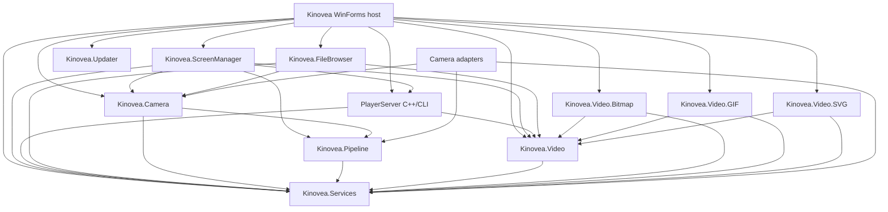

# Evidence: Epic 01 Windows API and Assembly Inventory v1

**Beads:** `Kinovea-gh23` / GitHub #23 (`E01-T01`)  
**Source branch:** `port/net10-linux`  
**Source commit:** `78dad5ad3897b12596cdebdb7821454b009b4fe8`  
**Source tree:** `49e02814bc83d287c5fdf1a108bd9d0633c995b8`  
**Review date:** 2026-10-22  
**Evidence type:** static project and source inspection; no runtime claim

## Scope and method

This inventory follows the original desktop project references into `ScreenManager`, `Services`, `Camera`, `Pipeline`, `Video`, `FileBrowser`, reader adapters and the C++/CLI PlayerServer. It also records the already separate .NET 10 projects to make the present migration boundary explicit.

Inspection used the checked-in `.csproj`/`.vcxproj` files, source references below, and these read-only searches from the source root:

```sh
rg -n 'DllImport|LibraryImport|System\.Drawing|Windows\.Forms|Microsoft\.Win32|ManagementObject|WMI|ComImport|shell32|user32|kernel32|winmm\.dll|DirectShow' \
  --glob '*.cs' --glob '!**/bin/**' --glob '!**/obj/**'
rg -n '\[DllImport' --glob '*.cs' --glob '!**/*.Designer.cs' --glob '!tests/**' --glob '!src/**'
```

Project and source line references were checked manually. Namespace-import counts are only a search aid: `System.Drawing` also supplies value types such as `Point`, `Size`, `Rectangle` and `Color`; an import alone does not prove a runtime GDI+ call. Generated WinForms designer files are not counted as behavioral evidence. No build, test, playback, camera, or native interop execution was performed for this source inventory (`NOT_RUN`).

Project-reference extraction was performed with:

```sh
python - <<'PY'
import os
import xml.etree.ElementTree as ET
for root, dirs, files in os.walk('.'):
    dirs[:] = [d for d in dirs if d not in ('.git', 'bin', 'obj', 'packages')]
    for name in files:
        if name.endswith(('.csproj', '.vcxproj')):
            path = os.path.join(root, name)
            tree = ET.parse(path).getroot()
            for item in tree.iter():
                tag = item.tag.split('}')[-1]
                if tag in ('TargetFramework', 'TargetFrameworkVersion'):
                    print(path, tag, item.text)
                elif tag == 'ProjectReference':
                    print(path, 'ProjectReference', item.attrib.get('Include'))
                elif tag == 'PackageReference':
                    print(path, 'PackageReference', item.attrib.get('Include'), item.attrib.get('Version'))
PY
```

## Assembly dependency graph

The arrows below are project references from project files, not proof that every registered feature is exercised in a normal session.



Project reference evidence: `Kinovea/Kinovea.csproj:388-439`, `Kinovea.ScreenManager/Kinovea.ScreenManager.csproj:1457-1476`, `Kinovea.FileBrowser/Kinovea.FileBrowser.csproj:329-340`, `Kinovea.Camera/Kinovea.Camera.csproj:246-253`, `Kinovea.Pipeline/Kinovea.Pipeline.csproj:121-124`, `Kinovea.Video/Kinovea.Video.csproj:239-242`, `Kinovea.Video.Bitmap/Kinovea.Video.Bitmap.csproj:104-111`, and matching GIF/SVG project reference groups. The classic C# projects shown here target .NET Framework 4.8. `PlayerServer.vcxproj` is C++/CLI targeting CLR v4.8 with Visual Studio C++ infrastructure; it is not an SDK-style portable TFM.

The production host's explicit reader registration is in `Kinovea/Kernel.cs:136-145`; built-in camera registration and plugin loading are at `Kinovea/Kernel.cs:149-161`. The image open path selects a reader in `Kinovea.ScreenManager/PlayerScreen/FrameServerPlayer.cs:120-180`. These are source call sites, not an end-to-end runtime test.

## Portability boundary by assembly

| Assembly / project | Source disposition | Project coupling | Verified platform surface in source | Migration implication |
|---|---|---|---|---|
| `Kinovea` | `BLOCKED` as a Linux host in its current form; no cross-platform execution established. | Main host references ScreenManager, FileBrowser, Services, Camera, Updater, Bitmap/GIF/SVG readers, Video and PlayerServer (`Kinovea.csproj:388-439`). | WinForms startup/menu/window host; `System.Drawing`; user32 `ChangeWindowMessageFilterEx` and `FindWindow` (`Kinovea/NativeMethods.cs:131-137`); Windows-oriented NAudio packages and process launch for links. | Keep as the legacy Windows host. New .NET 10 desktop host is parallel and does not reuse this assembly. |
| `Kinovea.ScreenManager` | `BLOCKED` as-is by net48/UI/native dependencies; separable subcomponents are `NOT_RUN` individually. | Camera, Pipeline, Services, PlayerServer and Video (`Kinovea.ScreenManager.csproj:1457-1476`). | Extensive WinForms controls and `System.Drawing` rendering/geometry; OpenCvSharp assembly references; `winmm` multimedia timers and `user32` monitor/display/icon/window-message APIs (`NativeMethods.cs:14-130`, `UIHelper.cs:51-65`, `PlayerScreen/Controls/PlayerScreenUserInterface2.cs:2986-3000`). | Not portable as an assembly. Domain/geometry pieces may be separable, but ScreenManager itself is tightly coupled to UI, Bitmap, OpenCV and FFmpeg. Extract only after consumer and serialization/API dependencies are mapped. |
| `Kinovea.Services` | Whole assembly `BLOCKED` as a direct Linux dependency; isolated pure methods `NOT_RUN` unless separately characterized. | No project references (`Kinovea.Services.csproj`). | `System.Drawing`, WinForms, System.Management/WMI (`Diagnostics/WMI/WMI.cs:28-174`); kernel32 `AttachConsole`, `GetModuleHandle`, `GetProcAddress`; msvcrt `memcpy`; user32 window/process-message APIs (`Infrastructure/NativeMethods.cs:14-42`); TurboJPEG P/Invoke (`Bitmap/TJPEG/tjnet.cs:15-153`); `explorer.exe` launch (`Filesystem/FilesystemHelper.cs:67-79`). | Mixed shared utilities and platform services. Do not port the whole assembly as one unit. `TimeHelper` and other pure methods need their own dependency and behavior checks. |
| `Kinovea.Video` | `BLOCKED` as a direct cross-platform contract; replacement behavior `NOT_RUN`. | Services (`Kinovea.Video.csproj:239-242`). | `VideoFrame.Image` exposes `System.Drawing.Bitmap`; `IFrameGenerator.Generate` returns Bitmap and its size/rotation surface uses System.Drawing (`Caching/VideoFrame.cs:30-57`, `VideoReaders/IFrameGenerator.cs:22-73`); reader selection also refers to WinForms (`VideoTypeManager.cs`). | This is the cross-cutting image type boundary: replacing it affects readers, caches, ScreenManager, thumbnails, OpenCV and export. Keep existing net48 API unchanged during parallel migration. |
| `Kinovea.Video.Bitmap` | Legacy reader characterization `TESTED` on Windows; Linux/modern portable reader `NOT_RUN`. | Services and Video. | GDI+ file decode/rotation/orientation in `FrameGeneratorImageFile.cs`; production reader wraps that generator in `VideoReaderBitmap.cs`. | Windows legacy reference. The isolated `net10.0-windows` adapter is not a Linux decoder or production replacement. |
| `Kinovea.Pipeline` | `BLOCKED` as a direct portable assembly by net48 and Bitmap event/consumer contracts; new boundary `NOT_RUN`. | Services. | `ConsumerJPEG` uses `Bitmap`, `LockBits`, and `Marshal.Copy`; frame event contracts expose Bitmap (`Consumers/ConsumerJPEG.cs:6-59`, `Events/Frame*EventArgs.cs`). | Capture frame payloads and video frames are distinct contracts. Characterize their ownership/pixel layouts before splitting. |
| `Kinovea.Camera` | `BLOCKED` as a direct portable assembly by WinForms/System.Drawing API coupling; device contract extraction `NOT_RUN`. | Pipeline and Services. | WinForms configuration/manager classes and System.Drawing summary/image events (`CameraManager.cs`, `CameraTypeManager.cs`, `Interfaces/ICaptureSource.cs`, `Events/CameraThumbnailProducedEventArgs.cs`). | Shared camera contracts currently pull UI/image types into every camera adapter. Separate shared acquisition contracts from each UI/device adapter. |
| `Kinovea.FileBrowser` | `BLOCKED` as-is by WinForms and Windows shell APIs. | Camera, Services, Video. | WinForms tree/browser; shell32 icon and known-folder APIs, user32 `SendMessage`, and uxtheme `SetWindowTheme` (`NativeMethods.cs:82-100`, `BrowserTreeController.cs:338-380`, `ShellSystemImageList.cs:39-66`). | Windows shell-specific browser cannot be reused unchanged on Linux. The file-selection domain should not inherit shell icon/control assumptions. |
| `Kinovea.Camera.DirectShow` | `BLOCKED` for Linux on its current DirectShow/AForge implementation. | Camera, Pipeline, Services. | AForge DirectShow classes and WinForms configuration. | Windows capture adapter; defer to a platform device boundary. |
| `Kinovea.Camera.HTTP` | `NOT_RUN` on Linux; current project is net48 and UI-bound. | Camera, Pipeline, Services. | AForge.Video plus WinForms UI. | Network transport may be portable, but current adapter and UI package graph is not proven portable. |
| `Kinovea.Camera.FrameGenerator` | `BLOCKED` as-is by WinForms/GDI+/winmm; pattern/timing extraction `NOT_RUN`. | Camera, Pipeline, Services. | Synthetic frames still use GDI+/WinForms; `winmm.timeSetEvent/timeKillEvent` (`Device/NativeMethods.cs:11-14`, `Device/FrameGeneratorDevice.cs:143-152`). | The pixel pattern may be reusable after detaching the timing and bitmap implementation. |
| Vendor camera projects | `BLOCKED` pending vendor Linux SDK/runtime and hardware evidence. | Camera, Pipeline, Services. | Basler Pylon, IDS uEye, Daheng GX, Baumer BGAPI/GenICam vendor SDKs; GenICam additionally references OpenCvSharp and Windows runtime package (`Kinovea.Camera.*/*.csproj`). | Separate hardware/vendor blockers; no Linux device compatibility inferred from managed source. |
| `Kinovea.Video.GIF` / `.SVG` | Linux behavior `NOT_RUN`; current GDI+ implementations cannot be used as portable decoders as-is. | Services and Video. | System.Drawing/GDI+ decode/rendering; SVG uses SharpVectors. | Their formats need characterization and adapter boundaries; not implied portable by portable BMP/PNG support. |
| `PlayerServer` | `BLOCKED` on Linux by C++/CLI/Visual Studio C++ target requirements. | C++/CLI project referenced by app and ScreenManager; it references Services and Video. | `/clr`, CLR v4.8, FFmpeg native API and CLR Bitmap/Video contracts (`PlayerServer.vcxproj`, `VideoReaderFFMpeg.h`, `VideoReaderFFMpeg.cpp`). | Largest framework/native bridge. Preserve decode, seek, timestamp, color-conversion and buffer semantics; do not infer that a C# API inventory is a decoder replacement plan. |

The checked-in parallel .NET 10 path (`src/Kinovea.PortablePixels`, `PortableImageReader`, `PortableFrameGenerator`, `PortableReaderShell`, `PortableDesktop.Presentation`, `PortableDesktop`) is built as SDK-style `net10.0` projects with Avalonia/SkiaSharp. `PortablePixels.GdiPlus` is explicitly `net10.0-windows10.0.17763.0` and must remain Windows-only. This distinction follows each project file; this document does not assert test/runtime results.

## Native and framework APIs located

| Platform/API | Source references | Effect and boundary |
|---|---|---|
| WinForms | Main host `Program.cs`, `Kernel.cs`; ScreenManager controls and forms; FileBrowser; Services helpers; Camera managers/configuration | UI and controls, not only the window shell, appear throughout the current application graph. `ScreenManager` has particularly broad control, drawing and event coupling. |
| GDI+ / System.Drawing | `VideoFrame`, `IFrameGenerator`, `VideoReaderBitmap`, `FrameGeneratorImageFile`, `BitmapHelper`, capture events and `ConsumerJPEG`, ScreenManager renderers/overlays/thumbnails/exporters | `System.Drawing` identifiers include both value types and actual GDI+ calls. Actual image operations include Bitmap construction, `Graphics`, `LockBits`, `RotateFlip`, JPEG/TurboJPEG and `Marshal.Copy`/unsafe row copies. |
| user32 | `Kinovea/NativeMethods.cs:131-137`; `Kinovea.Services/Infrastructure/NativeMethods.cs:26-42`; `Kinovea.ScreenManager/NativeMethods.cs:29-130`; `Kinovea.FileBrowser/NativeMethods.cs:97` | Single-instance/window focus and WM_COPYDATA messaging; display enumeration, high-resolution UI timer integration, icon disposal, tree control messages. |
| shell32 / uxtheme | `Kinovea.FileBrowser/NativeMethods.cs:82-100` | Shell icon indexes, stock icons, known-folder PIDLs, and Windows Explorer theme. |
| kernel32 / msvcrt / ntdll | `Kinovea.Services/Infrastructure/NativeMethods.cs:14-23`; `PlatformHelper.cs:20-31` | Console attachment, module/procedure lookup, CRT memory copy and Wine detection by probing `wine_get_version`. |
| winmm | `Kinovea.ScreenManager/NativeMethods.cs:14-17`; `Kinovea.Camera.FrameGenerator/Device/NativeMethods.cs:11-14` | Multimedia timer APIs; used in ScreenManager refresh/timing and synthetic camera timer. |
| WMI / System.Management | `Kinovea.Services/Diagnostics/WMI/WMI.cs:28-174`; reference in `Kinovea.Services.csproj` | Windows machine/process/device information. Source inspection found `using Microsoft.Win32` in capture code but no `Registry.*`/`RegistryKey` call in the scanned production directories; an assembly/package reference alone is not evidence of registry behavior. |
| Native codecs and interop | `Kinovea.Services/Bitmap/TJPEG/tjnet.cs:15-153`; camera unsafe copies; `PlayerServer` FFmpeg C++/CLI | Deployment requires compatible native libraries/SDKs and ABI/bitness. Exact vendor native resolution was not executed here. |

## Migration implications and explicit uncertainty

1. The first safe extraction points are narrow code with no platform types in its public signatures, or parallel implementations behind the portable .NET 10 path. This inventory does not designate `ScreenManager`, `Services`, `Camera`, or `Video` as portable.
2. `System.Drawing` is not a single category: `Point`/`Size` metadata may be replaced or adapted separately from GDI+ decode/render operations, but source callers and serialized representations must be checked before doing so.
3. `WinForms` appears in shared Services/Video/Camera APIs as well as UI code. Moving a UI form alone will not compile a new cross-platform assembly while those signatures remain referenced.
4. A Windows P/Invoke found by search identifies a concrete porting boundary, not its real-world execution frequency. Tests and production call graphs must establish which paths are used.
5. Vendor DLL deployment, device lifecycle, native FFmpeg/C++/CLI runtime and actual capture/playback behavior remain unverified. This task does not run native components.
6. The source scan is bounded to checked-in C# declarations and project files; dynamic loading, reflection, indirect native calls, resource-generated code and transitive package behavior may expose additional platform requirements.
7. This scan assigns no new `PORTED` status: a static dependency map cannot meet the Linux build and acceptance-test gate. `BLOCKED` describes current assembly reuse blockers, while runtime behavior remains `NOT_RUN` where it was not executed.

## Dependency-aware order proposed by this inventory

1. Keep the existing portable pixel/image/reader/desktop assemblies separate and retain the legacy reader registration. This inventory found no justification to connect those APIs to the WinForms host yet.
2. Complete `E01-T01` (this source map) before changing shared contracts.
3. In `E01-T02`, characterize and isolate time/frame/media contracts while preserving `long` timestamp semantics and the existing net48 types. No broad `VideoFrame` replacement until all consumers are mapped.
4. In `E01-T03`, move only Services methods whose call graph is platform-neutral; leave WMI, WinForms, user32/kernel32, TurboJPEG and shell launching behind explicit platform boundaries.
5. In `E01-T04`, build on the separate .NET 10 host/module path rather than referencing a net10 assembly from net48. Reader selection should preserve current extension precedence and failure behavior through characterization.
6. Do `E01-T05` ownership/concurrency characterization before any portable producer is connected to legacy cache/export/OpenCV consumers. Keep FFmpeg and camera device adapters outside this first contract slice.
7. Only after those prerequisites, migrate ScreenManager/UI consumers in small vertical slices; leave DirectShow/vendor cameras and C++/CLI FFmpeg until their runtime and native packaging boundaries are explicit.

## Verification record

- Source SHA: `78dad5ad3897b12596cdebdb7821454b009b4fe8`.
- Source tree SHA: `49e02814bc83d287c5fdf1a108bd9d0633c995b8`.
- Commands: the two `rg` searches above, project-file parsing, and manual source reads cited in the inventory.
- `git diff --check` in the isolated task worktree: exit `0` after the documentation edits.
- Builds, tests, Windows, hardware, Wine and native library execution: `NOT_RUN` for this inventory.
- Claim boundary: static source map only; no component is promoted to `PORTED`, `TESTED`, or `REGRESSION_VERIFIED` by this evidence.
