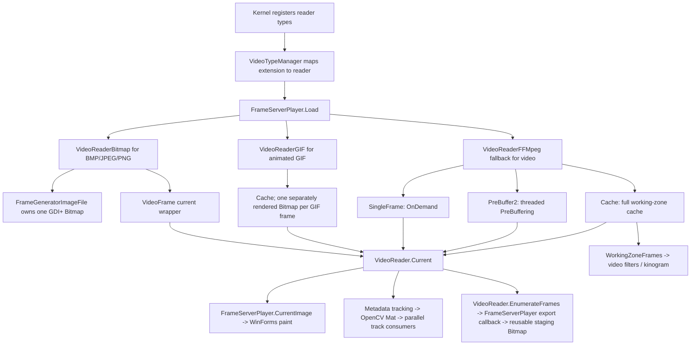

# Production video cache and consumer lifetimes v1

Status: **Source audit complete; direct Windows C# cache characterization passed; no end-to-end playback claim.**

## Provenance and method

- Repository: `jvteodoro/Kinovea`.
- Base: `port/net10-linux` at PR #8 merge commit `4fa173265c51f5a9ecd4a4b83c604a71cddabebc`, merged 2026-10-12 12:30:30 UTC. PR #8 head `8c316f1997919cf62fca7a4c0b677645417e01af` is its second parent. The audit branch was rebased onto the exact merge commit before changes.
- Audit branch: `audit/production-video-cache`.
- Source searches cover C#, C++/CLI, project/solution registration, UI, video filtering, OpenCV/tracking, and export call sites. Line references below are from the source revision above.
- Status vocabulary: `SOURCE_INSPECTED` is based on checked-in source; `EXECUTED_WINDOWS` requires the Windows workflow artifact for this task; `INFERRED` is an interpretation of source flow; `NOT_RUN` means no execution evidence.
- Legacy candidate Bitmap baseline remains `CANDIDATE_NOT_APPROVED`; no baseline files or approval metadata were changed.

## Production producer-cache-consumer graph



The graph is a source-backed dependency map, not a runtime playback trace. `Kernel` registers Bitmap, FFmpeg, GIF, and SVG readers explicitly (`Kinovea/Kernel.cs:136-145`). `VideoTypeManager` registers types and constructs the matching reader (`Kinovea.Video/VideoReaders/VideoTypeManager.cs:44-65,114-131`). `FrameServerPlayer.Load` selects by extension and opens the reader (`Kinovea.ScreenManager/PlayerScreen/FrameServerPlayer.cs:120-203`).

### Reader-specific paths

| Reader | Production cache use | Ownership source | Evidence |
|---|---|---|---|
| `VideoReaderBitmap` | None. It reports `OnDemand`; current frame is held directly by the reader. | `FrameGeneratorImageFile` loads one Bitmap, returns that same object for each timestamp, and disposes it on `Close`; `DisposePrevious` is intentionally a no-op. `VideoReaderBitmap.UpdateCurrent` calls it before replacing its wrapper. | `Kinovea.Video.Bitmap/VideoReaderBitmap.cs:42-87,104-107,264-286`; `FrameGeneratorImageFile.cs:52-82,94-113,126-166`. `SOURCE_INSPECTED`; actual reader lifecycle has prior Windows candidate characterization, but this audit did not execute it. |
| `VideoReaderGIF` | Uses `Cache` in production and exposes it as current and working-zone frames. | `LoadCache` creates a new `Format32bppPArgb` Bitmap for each selected GIF frame and inserts it with its timestamp. The default `Cache` path disposes each stored image on trim/clear. `Close` calls `cache.Clear()`. | `Kinovea.Video.GIF/VideoReaderGif.cs:34-80,83-100,174-261`; `Kinovea.Video/Caching/Cache.cs:168-201,219-227,260-270`. `SOURCE_INSPECTED`; GIF reader playback not executed in this audit. |
| `VideoReaderFFMpeg` | Constructs all three production caches and swaps `mFrameContainer` by mode. Opens in `OnDemand`; later UI/working-zone requests select `PreBuffering` or `Caching` where supported and within memory policy. | The FFmpeg reader supplies one custom `DisposeFrame` callback to all caches. Each decoded `Bitmap` wraps a converted FFmpeg `AVFrame` buffer and stores an additional `AVBufferRef` in `Bitmap.Tag`; disposal deletes the Bitmap and unreferences the FFmpeg buffer. Stabilization currently paints into an independent GDI+ bitmap before caching. | `VideoReaderFFMpeg.cpp:41-51,541-543,1187-1297,1346-1398,2281-2484,2868-2893`; `VideoReaderFFMpeg.h:263-270,470-483`. `SOURCE_INSPECTED`; the C++/CLI reader and FFmpeg decode path were not built or run in this audit. |
| `VideoReaderSVG` | No `SingleFrame`, `Cache`, or `PreBuffer2` construction found in the reader implementation. It has its own `IFrameGenerator` current-frame path. | GDI+ frame/image ownership is handled by its reader/generator. | `Kinovea.Video.SVG/VideoReaderSVG.cs` and `FrameGeneratorSVG.cs`. `SOURCE_INSPECTED`; no SVG runtime characterization in this task. |

Production construction search result: `SingleFrame`, `Cache`, and `PreBuffer2` are instantiated in `VideoReaderFFMpeg.cpp:45-49`; `Cache` is also instantiated in `VideoReaderGif.cs:79`. There are no C# production constructors for `SingleFrame`/`PreBuffer2`. The previous PR #8 record that said no production `SingleFrame` constructor existed searched C# call sites only and missed C++/CLI; this document corrects that scope error. The constructed `FrameGeneratorImageFile` plus `SingleFrame` misuse probe remains a synthetic combination and is not the still-image playback path.

## Cache usage and ownership matrix

| Cache / reader mode | Insertion and selection | Eviction / clear / disposal | Thread boundary and retained-reference limits |
|---|---|---|---|
| `SingleFrame` / FFmpeg `OnDemand` | `VideoReaderFFMpeg::ConvertAndStoreFrame` calls active container `Add`/`ForceAdd`; OnDemand performs synchronous decoding and replaces one slot (`VideoReaderFFMpeg.cpp:894-917,1090-1111,2461-2484`). | `Add` calls `Clear`; default `SingleFrame.Clear` disposes the image, but FFmpeg uses custom `DisposeFrame`. `ChangeCachingMode` clears it when leaving OnDemand (`SingleFrame.cs:85-113`; `VideoReaderFFMpeg.cpp:1365-1395`). | Source describes OnDemand calls on the UI or exporter thread. `SingleFrame` has no internal synchronization. The wrapper getter returns an ordinary field. Supported production call flow appears serialized; this audit has no FFmpeg runtime evidence. An external reference can outlive replacement and then refer to a disposed image. |
| `PreBuffer2` / FFmpeg `PreBuffering` | UI or exporter acquires closest/next under `sync`; decoder worker adds frames under the same lock and can block at capacity (`PreBuffer2.cs:129-220,225-319`; `VideoReaderFFMpeg.cpp:2902-3040`). | Acquire/seek/purge/shutdown collect removed frames under lock, then call the disposer outside it (`PreBuffer2.cs:134-171,494-558`). Current is retained by eviction rules while selected; after current advances, caller-held older wrappers are not protected by the cache. | This is explicitly a producer/consumer cache. FFmpeg stops and joins the prebuffer thread before shutting down/reconfiguring (`VideoReaderFFMpeg.cpp:2951-2973,1365-1379`). `CurrentFrame` returns a field without locking; collection mutation and selection are locked. No frame-retention lease is exposed. UI reads appear synchronous, but race freedom for callers that retain frames across navigation is not established. |
| `Cache` / GIF and FFmpeg `Caching` | GIF eagerly adds all decoded GIF frames; FFmpeg imports a working zone on a `BackgroundWorker`, then acquires synchronously by timestamp (`VideoReaderGif.cs:240-253`; `VideoReaderFFMpeg.cpp:1187-1207,1598-1649`). | `Trim` and `Clear` dispose removed images. GIF close clears all cached frames. FFmpeg supplies native-resource cleanup callback (`Cache.cs:168-201,260-270`). | The `Cache.cs` class comment says all methods run on UI thread, but FFmpeg calls `ReadManyToCache`/`mCache->Add` on a background worker (`VideoReaderFFMpeg.cpp:1598-1649` and later decode call). The production UI appears to wait for or pause around full-cache work; that is an inference, and concurrent access safety is not proven because `Cache` has no lock around its `SortedList`. `CacheSnapshot` is volatile-published, but that alone does not make other cache state safe for concurrent reads. |

### Source-level risk requiring follow-up

`PreBuffer2.ForceAdd` invokes `EvictOne(0)` when full but ignores the returned removed-frame list (`PreBuffer2.cs:299-319,796-807`). `EvictOne` removes a frame and returns it without invoking `DisposeFrame`; ordinary acquisition/purge paths do invoke the callback. The FFmpeg reader calls `mPreBuffer->ForceAdd` when resubmitting a pending decoded frame (`VideoReaderFFMpeg.cpp:3781-3815`), and its callback owns both the GDI+ Bitmap and FFmpeg `AVBufferRef`. This is a **source-inspected resource-release defect path**; full FFmpeg reachability and an actual native-buffer leak have not been executed here. The added cache harness records whether the callback fires for a full-capacity forced eviction, without asserting that a missing callback is desired. No production fix is included in this audit.

`Cache.ForceAdd` is different: it delegates to `Add` and does not evict (`Cache.cs:160-163`). Do not generalize the `PreBuffer2.ForceAdd` finding to `Cache`, `SingleFrame`, or every cache.

## Production consumers and lifetime edges

- **Display:** `FrameServerPlayer.CurrentImage` returns the active filter's Bitmap or `VideoReader.Current.Image` directly (`FrameServerPlayer.cs:63-79`). `PlayerScreenUserInterface2.SurfaceScreen_Paint` draws it synchronously through GDI+ (`PlayerScreenUserInterface2.cs:4700-4740`). The frame remains owned by the reader/container, not the paint caller. This source path is not executed end-to-end by the characterization harness.
- **Tracking/OpenCV:** `Metadata.PerformTracking(VideoFrame)` converts its Bitmap to an OpenCV `Mat`, disposes that Mat with `using`, and passes it to a `Parallel.ForEach` of track consumers (`Metadata.cs:1672-1695`). `DrawingTrack.PerformTracking` explicitly states the per-track work runs in parallel (`DrawingTrack.cs:1571-1628`). `BitmapConverter.ToMat` is the ownership/conversion boundary; whether it copies every input layout is not measured here. Concurrency with reader eviction is not characterized.
- **Camera motion and filters:** camera motion reads each cached frame's `Bitmap`, converts it to OpenCV, then disposes the Mat (`CameraTracker.cs:185-210`). Kinogram code retains `VideoFrame` wrappers returned from `WorkingZoneFrames.Frames` (`VideoFilterKinogram.cs:797-825`) and later reads their images. `Cache.Trim/Clear` disposal while such wrappers are retained is a lifetime edge to test before changing storage ownership.
- **Export:** `VideoReader.EnumerateFrames` yields current `VideoFrame`s; `FrameServerPlayer.EnumerateImages` requires prebuffering to be off, invokes `ImageRetriever` synchronously, paints into one reusable staging Bitmap and yields that same staging object. Its comments require callers to copy if they retain the yielded image (`VideoReader.cs:350-391`; `FrameServerPlayer.cs:532-595,603-655`). Frame readers remain owners during each callback; the callback output is staging-owned.
- **Thumbnails / summary:** each reader implements `ExtractSummary`; Bitmap/GIF paths build GDI+ thumbnails and pass them through `VideoSummary.Thumbs`. `VideoReaderBitmap` uses the generator image to draw a separate thumbnail (`VideoReaderBitmap.cs:109-130`); GIF creates independent frame bitmaps. The existing reader tests cover only selected still-image summary behavior; GIF and FFmpeg thumbnail resource lifetimes are not verified by this task.
- **Final release:** the reader/cache close or mode transition triggers callback/default disposal. `VideoFrame` is a non-disposable wrapper with a readonly Bitmap/timestamp pair (`VideoFrame.cs:30-58`). A caller holding a wrapper has no ownership API to extend the underlying Bitmap lifetime.

## Executable Windows characterization added for this audit

The existing `tests/Bitmap.Characterization` executable directly exercises the real C# `Cache` and `PreBuffer2` types (the exact production classes used by GIF and FFmpeg). It records wrapper/current identity, timestamps, callback timestamps, Bitmap usability, Clear/Purge/Shutdown outcomes, interrupted-add ownership, and full-capacity `PreBuffer2.ForceAdd` observations. The workflow is still `workflow_dispatch` and uploads its entire artifact directory under `if: always()`.

| Question | Method/result | Status |
|---|---|---|
| Cache add/acquire/trim/clear uses supplied disposer and releases only evicted images | Direct real `Cache` instance with small authored bitmaps and a test callback that disposes Bitmap and records timestamp. Trim retained timestamp 1, disposed 2 then 0; Clear disposed 1; sequential Dispose made no further callback. | `PASS` in run [38251549851](https://github.com/jvteodoro/Kinovea/actions/runs/38251549851), cache subcase 65 assertions overall. |
| PreBuffer2 add/acquire-next/purge/shutdown and post-shutdown add behavior | Direct real `PreBuffer2` instance with deterministic timestamps and callback. AcquireNext selected timestamp 20 after 10; Purge disposed 10 then 0 and retained current 20; Shutdown disposed 20. Add after shutdown returned `Interrupted`; rejected Bitmap remained usable and caller-owned. | `PASS` in run [38251549851](https://github.com/jvteodoro/Kinovea/actions/runs/38251549851). |
| Full-capacity `PreBuffer2.ForceAdd` disposal callback | At capacity 32, forced add evicted timestamp 8; callback had not fired and its Bitmap remained usable before teardown. This is observational and does not assert that a missing callback is desired behavior. | `PASS` as an observed outcome in run [38251549851](https://github.com/jvteodoro/Kinovea/actions/runs/38251549851); confirms the C# cache callback omission, not an FFmpeg native leak. |
| Actual FFmpeg open/decode/seek/mode-switch/display/export | Requires the C++/CLI PlayerServer, FFmpeg binaries and Windows media fixture; not part of the C# characterization runner. | `NOT_RUN`; source inspection only. |
| Actual GIF reader open/animation navigation | Not added to harness; test invokes the exact shared `Cache` implementation but not `VideoReaderGIF`. | `NOT_RUN`; source inspection only. |

The workflow built and executed the actual net48 characterization harness at source SHA `cbc3c16a7ad811e00b9b73cf153f1796f2d9adfa`. Overall report: `PASS`, 24 cases, 739 assertions passed, 0 failed. The direct `production-cache-contracts` case passed 65 assertions. The Windows runner was `windows-2022`, image `20261004.326.1`, OS `Microsoft Windows NT 10.0.20348.0`, x64, PowerShell 7.6.6, Visual Studio MSBuild `17.14.60.43110`, .NET Framework 4.8 targeting pack present (FrameworkList SHA-256 `e7f1f8a36f6dd41334a22a156f2822dce0e6b66186a35c643c8dfd784f7c018a`). Harness metadata reports CLR `4.0.30319.42000`, GDI+ `10.0.20348.5622`, and reader type `Kinovea.Video.Bitmap.VideoReaderBitmap`. The workflow's artifact manifest records 89 files and per-file sizes/SHA-256 values in [production cache artifact hashes](production-video-cache-artifact-sha256-v1.json); manifest SHA-256 is `a587f3f776f938fedf068f6c1483b9cc54491e2be923d911f4d1ba66c57d07d6`. Key hashes: test report `641b7a7e2466479ecc437e1cf1588be7c712d23c01bdbeadc9d3a73d04a85848`, trace `cf1f6a60eb6047e1da167aee30f619eceb0e3ae5436bec818cbbe45d15afe3ab`, source-hash manifest `a67ef8cfbfc02301df37f9496ee0367403857d1e6736047a1f9a90381885b6a9`, runner metadata `49f3c80283412501bcb9ae8cb3add2907469102006443eafbdecb3ae99d5dd72`, and runtime metadata `658b925f12a19e5ff407d5eea80d8ddaf73387c369ab040fdf521d64d9c5a6a2`. Source manifest has 62 configured files and no missing entries.

One inherited case observation says there are no production `SingleFrame` constructor call sites. That observation came from the earlier C#-only search and is superseded: this audit found the actual C++/CLI constructors in `VideoReaderFFMpeg.cpp:45-49`. It is metadata in the older isolated-probe case, not an assertion or an executable test of production constructor discovery. The `production-cache-contracts` case separately records the corrected call-site map. Thus the aggregate 739 assertions are valid behavioral checks, but call-site inventory is established by this source audit, not by those assertions.

Local command attempted on Gentoo Linux x86_64, .NET SDK 10.0.111 / runtime 10.0.11:

```sh
dotnet build tests/Bitmap.Characterization/Kinovea.Bitmap.Characterization.csproj --configuration Release -p:NuGetAudit=false -p:MSBuildEnableWorkloadResolver=false -m:1
```

Result: exit 1, `MSB3644` because the .NET Framework 4.8 reference assemblies are absent. This is an environment limitation, not a Windows test failure. Windows workflow run [38251549851](https://github.com/jvteodoro/Kinovea/actions/runs/38251549851) independently built and ran the harness successfully. Local `git diff --check` passed. The Windows trace covers the actual C# cache classes only; complete GIF and FFmpeg production reader execution remains `NOT_RUN`.

## Integration alternatives and recommendation

For the portable BMP/PNG reader, the production SingleFrame/PreBuffer2 path is not the immediate integration point. The actual still-image path is `VideoReaderBitmap -> FrameGeneratorImageFile -> VideoFrame -> FrameServerPlayer.CurrentImage`; it has no cache. The GIF reader uses `Cache`; FFmpeg uses all three containers.

| Candidate | Benefits | Risks / reason not selected now |
|---|---|---|
| Connect portable reader to existing `VideoReaderBitmap` / `FrameServerPlayer` | Matches the production BMP/PNG file-selection and current-image boundary; bypasses caches as the existing still-image reader does. | Existing application and consumers are .NET Framework 4.8; portable reader/shell is `net10.0`. The net48 application cannot reference a `net10.0` assembly in-process. `Kinovea.Video`, ScreenManager and UI contracts also expose GDI+ and WinForms. Requires a coordinated target/host transition, not a local cache adapter. |
| Connect to production `SingleFrame` | Appears small in isolation. | This cache is used by FFmpeg OnDemand and owns each distinct native-backed frame through a custom disposer. It is unrelated to the Bitmap still-image path, and generator-owned storage conflicts with its disposal-on-replacement semantics. Do not use it to force the reader into playback. |
| Connect to GIF/FFmpeg `Cache` or `PreBuffer2` | Production code already stores Bitmap frames there. | GIF uses independent PArgb frames; FFmpeg uses unique AVBufferRef-backed frames and threaded/prebuffer/cache modes. A still-image reader returning one shared PixelBuffer has different lifetime and navigation semantics. The unverified forced eviction path adds native resource risk. |
| Process boundary from net48 to net10 | Could keep old application runtime while hosting new decoder separately. | Requires IPC protocol, frame serialization/copies, crash/restart semantics and latency measurements; no demonstrated benefit over eventual host convergence. |

**Recommendation:** do not attach `PortableImageFrameGenerator` to any existing cache. The narrowest real production edge is the extension-selected still-image reader/current-image path (`VideoTypeManager.GetVideoReader` -> `FrameServerPlayer.Load` -> `CurrentImage`), which must bypass caches just as `VideoReaderBitmap` does. Before coding at that edge, make one dedicated host/framework decision: either migrate the relevant application dependency chain to a common .NET 10 target (Windows first while Linux UI remains unresolved), or justify and specify an out-of-process protocol. The next implementation task should then be one vertical still-image slice with `.bmp`/`.png` dispatch, current frame, close, and paint/export handoff, leaving FFmpeg caches and the legacy reader unchanged. Its acceptance tests must compare open/navigation/timestamps/dimensions/pixels/disposal to the Windows reader trace; exercise current-image consumption; prove no use-after-close; and keep cache integration, GIF/SVG, tracking and full playback out of scope.

## Components to leave unchanged

`VideoReaderBitmap`, `FrameGeneratorImageFile`, `VideoReaderGIF`, `VideoReaderFFMpeg`, `VideoFrame`, `IFrameGenerator`, `SingleFrame`, `Cache`, `PreBuffer2`, cache eviction policies, timestamps, image geometry/rotation, OpenCV algorithms, `FrameServerPlayer`, ScreenManager/WinForms painting, exporter callbacks, thumbnails, FFmpeg and its disposal callback. This audit changes only the Windows characterization harness and documentation.
